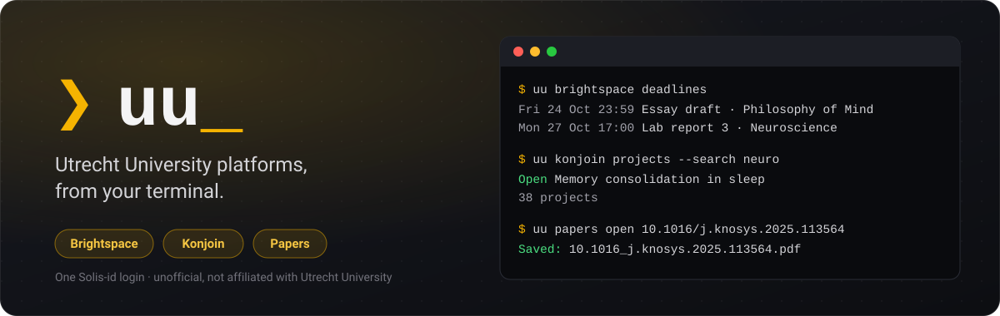
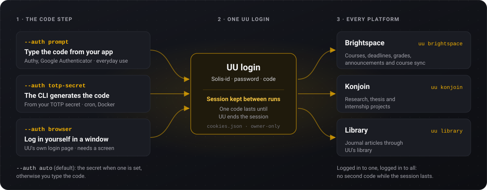

<p align="center">
  
</p>

# UU CLI

Headless CLI for Utrecht University platforms, logged in with your Solis-id:

- **[Brightspace](https://uu.brightspace.com)** (`uu brightspace`): mirrors your courses to
  a local folder (slides, PDFs, assignment instructions, linked files and schedules) and
  lists courses, assignments, deadlines, grades and announcements.
- **[Konjoin](https://uu.konjoin.nl)** (`uu konjoin`): lists and searches research,
  thesis and internship projects, shows a project's details and exports them all to JSON.
- **Library** (`uu library`): journal articles. Opens an article through UU's library in a browser
  window and saves the PDF you, or the window itself, open there, or downloads Elsevier
  articles through Elsevier's API.

## Features

- **Full material download** of every module and topic, including files linked from inside pages.
- **All courses at once** with `sync-all` (skips group/team sections).
- **Deadlines** from Brightspace dropboxes merged with linked Google Sheets schedules.
- **Incremental**: files already on disk are skipped.
- **Headless login** with cached session and token: type one code from your
  authenticator app, or let the CLI generate codes from your TOTP secret.
- **One login for every platform** while UU's session lasts: after a Brightspace login,
  Konjoin logs in without asking for another code.

## Limitations

- **Codes, not push, in the terminal.** Logging in headless needs an authenticator app
  (TOTP) for the 6-digit codes; UU's push-notification approval can't work there. A browser
  window (`--auth browser`) shows UU's own login page, so push should work there, but it
  hasn't been tried yet.
- **UU only.** The login flow is written for UU's Solis-id login page.
- **Can break** if UU, D2L, SURFconext, Konjoin or UU's library proxy change their pages.

## Install

Python 3.10+ and Chromium.

```sh
python3 -m venv .venv && source .venv/bin/activate
pip install -e .
python -m playwright install --with-deps chromium
```

This installs the `uu` command. `python3 brightspace-cli.py <command>` keeps working and
is the same as `uu brightspace <command>`.

## Logging in

UU asks for your Solis-id, your password and a 6-digit code from your authenticator
app. The CLI can answer the code step in two ways, or let you log in yourself, chosen
with `--auth` (or `BRIGHTSPACE_AUTH`). Whichever you pick, the result is one UU session
that every platform shares:

<p align="center">
  
</p>

| `--auth` | The code comes from | Good for |
|---|---|---|
| `prompt` | you: the CLI asks for the code your app shows (Authy, Google Authenticator, …) | everyday use; the TOTP secret never leaves your phone |
| `totp-secret` | the CLI, generated from your TOTP secret | unattended runs (cron, Docker); the secret lives on this machine |
| `browser` | you, in a browser window the CLI opens on UU's own login page | a desktop; the CLI never sees your password or code |
| `auto` (default) | the secret when one is set, otherwise you at the prompt | |

With `browser`, the window only opens when UU's session has run out. Log in there as
you would anywhere; once you're back on the platform, the CLI takes the session over and
closes the window (it waits up to 5 minutes). It needs a screen: a desktop, or WSLg on
Windows.

With `prompt`, a login looks like this; the CLI also asks for your Solis-id and
password when they aren't set:

```sh
uu brightspace login
# Code from your authenticator app: 123456
```

After a login the CLI keeps the session cookies in the session directory
(`cookies.json`, owner-only), so later commands, including `sync`, reuse the login
until UU or Brightspace ends the session. Only then does it ask for a code again.
Those cookies work like a login for as long as the session lasts; delete the file to
log out.

## Configuration

Store your credentials encrypted once:

```sh
uu brightspace save-creds
```

This prompts for your Solis-id, password, TOTP secret and a passphrase, and writes
them to `credentials.enc` (scrypt + AES-256-GCM, mode `0600`). Leave the TOTP secret
empty to keep typing codes from your app (`--auth prompt`). Whenever a login is
needed, the CLI asks for the passphrase. To skip the prompt (cron, Docker), set
`BRIGHTSPACE_PASSPHRASE`. Keep the passphrase out of files, or the encryption gains
you nothing.

Or pass the credentials as environment variables, which take precedence over the
saved file:

```sh
export BRIGHTSPACE_SOLISID=...
export BRIGHTSPACE_PASSWORD=...
export BRIGHTSPACE_TOTP_SECRET=...
```

Your password and TOTP secret sit together in the same place, so anyone who gets
both bypasses MFA. Avoid `--password`/`--totp` flags: they show up in `ps` and
shell history.

Optional: `BRIGHTSPACE_ORG_UNIT` (default course), `BRIGHTSPACE_BASE_URL`,
`BRIGHTSPACE_SESSION_DIR`, `BRIGHTSPACE_TOKEN_FILE` and `BRIGHTSPACE_CREDS_FILE`
(default `../brightspace/` next to the repo). The token and session are bearer
secrets and are kept owner-only. To keep them off disk, point them at a tmpfs such
as `$XDG_RUNTIME_DIR`.

### Getting your TOTP secret

Only needed for `--auth totp-secret`. The CLI then generates MFA codes itself, so it
needs the secret key behind your authenticator entry (e.g. `JBSWY3DPEHPK3PXP`).

[MySolisID](https://mysolisid.uu.nl) allows only one authenticator, so you either
export the secret from your current app or set the authenticator up again.

**Export from your current app.** Aegis, 2FAS, Bitwarden, 1Password and KeePassXC
show the secret in the entry's details or export. Google Authenticator's "Transfer
accounts" QR holds an encoded `otpauth-migration://` URI that needs a decoder tool.

**Or set it up again.**

1. In MySolisID > Two-factor authentication, choose "Deactivate with Authenticator".
2. Activate it again. At the QR code, copy the key shown for manual entry, or decode
   the QR with `zbarimg qr.png` and take the `secret=` value from the `otpauth://` URI.
3. Scan the same QR with your phone's authenticator and finish activation with a code
   from it. Phone and CLI now share the same secret.

## Usage

```sh
uu brightspace save-creds                     # Store credentials encrypted
uu brightspace login                          # Authenticate and cache a token
uu brightspace courses                        # List enrolled courses
uu brightspace sync --org-unit <id> -o out    # Download one course
uu brightspace sync-all -o out                # Download every course
uu brightspace sync-all --dry-run             # Preview without downloading
uu brightspace deadlines                      # Upcoming deadlines
uu brightspace assignments | grades | news | toc | schedule
```

All commands except `login`, `courses` and `sync-all` need a course's org-unit id:
pass `--org-unit <id>` (find ids with `courses`) or set `BRIGHTSPACE_ORG_UNIT`.
Output goes to `<out>/<org-unit>/`. Run with `--help` for all options.

### Konjoin

```sh
uu konjoin projects                           # First page of projects (no login needed)
uu konjoin projects --search neuro --all      # Every project matching "neuro"
uu konjoin project 3208-some-project-title    # One project's details (logs in if needed)
uu konjoin export -o projects.json            # Every project, all pages, as JSON
uu konjoin login                              # Log in ahead of time
```

Public projects are listed without a login; project details need one. Konjoin logs
in through SURFconext, which the CLI answers with "Utrecht University", then UU's
Solis-id page as usual. The login options and variables (`--auth`, `save-creds`,
`BRIGHTSPACE_SOLISID`, …) are shared with Brightspace, as is the browser session.
If SURFconext asks for your consent to share your details with Konjoin, log in once
in a normal browser to give it. Optional: `KONJOIN_BASE_URL`.

Konjoin shows every logged-in user each person's email address and organisation id.
JSON output (`--json`, `export`) leaves both out, so an export isn't a list of everyone's
contact details; add `--keep-contact-details` if you need them.

### Library

```sh
uu library open 10.1016/j.knosys.2025.113564         # Through UU's library; the PDF you open is saved
uu library open https://link.springer.com/article/… -o papers/
uu library get 10.1016/j.knosys.2025.113564          # The same window, which opens the PDF itself
uu library watch -o papers/                          # get, for each DOI an AI agent adds to papers/wanted.txt
uu library elsevier 10.1016/j.knosys.2025.113564     # Elsevier's API (needs ELSEVIER_API_KEY)
```

`uu papers`, the old name, still works.

`open` takes a DOI or the article's web address, turns it into a link through UU's
library proxy (`utrechtuniversity.idm.oclc.org`, the same one the library's own links
use) and opens that in a browser window with your UU session, so while UU's session
lasts there is no login. Find the PDF as you always would: the first PDF you open or
download is saved, named after its DOI, and the window closes. When the PDF's address
has a DOI of its own, that one names the file and the CLI says so: a chapter page can
also offer the whole book. `--keep-open` keeps it
open for more (supplementary material) until you close it. It works for every publisher
UU subscribes to, and like `--auth browser` it needs a screen.

`get` opens the same window, so you still see it and log in when UU asks, but then opens
the PDF itself: the one the article page names in its `citation_pdf_url` tag, the tag
Google Scholar reads, which most publishers set. It opens that in a tab of the same
window, through the proxy when the address is the publisher's own, and saves it as
`open` does. When a page names no PDF, or a publisher's checks keep the PDF from coming
within half a minute, the window stays open and asks you to open it yourself. One
article per run, always in a window on your screen: never a download in the background.

#### With an AI coding agent

An agent such as Claude Code can't fetch an article through the library for you on its
own. Three things are in the way:

- **Your login.** It doesn't need your session cookie: `uu` uses its own saved session,
  the way `gh` uses its login. But that session is as good as your password for the
  library until it expires, so an agent should never read it.
- **The window.** `open` and `get` need a window on your screen. In Claude Code's sandbox
  on Linux, Chromium can't open one: the sandbox blocks the Unix sockets Chromium needs
  for its single-instance lock and the display, and it stops at `socket() failed:
  Operation not permitted`. Headless Chromium, which the other commands use, does run.
- **The network.** A sandbox lets through only the hosts on its list, and the library
  proxy is usually not on it. Publishers also refuse an agent's own web fetches (403),
  since those don't come from UU's network.

The way around all three is `watch`, which you start in your own terminal, outside the
agent's sandbox, and leave running:

```sh
uu library watch -o ~/thesis/literature/papers
```

The agent adds DOIs to `wanted.txt` in that folder, one per line (`#` starts a comment),
and waits for their line in `watch.log`: the DOI, a tab, then the saved file, or `no PDF`
when the window closed without one. For each new DOI, `watch` does what `get` does: a
window on your screen, where you log in if UU asks. It takes only DOIs from the list and
opens only their doi.org links, so nothing an agent writes there can run or open another
site. It fetches one article at a time, ten seconds apart, and stops after 25 (`--max`),
so a list that keeps growing can't turn into systematic downloading. A DOI already in
`watch.log` is skipped, also after a restart; to try one again, use `uu library get`.

Without `watch`, the agent gives you the command and the folder to save to, and reads
the PDF from that folder once you've run it.

`elsevier` uses Elsevier's Article Retrieval API, the route Elsevier allows for automated
access; its website terms forbid scripts that download from ScienceDirect. Get a personal
API key at [dev.elsevier.com](https://dev.elsevier.com/apikey/manage) and set
`ELSEVIER_API_KEY`. The key alone grants nothing: Elsevier gives full text when it sees
the request as UU's, from UU's network (on campus or eduroam). Elsewhere it needs an
institutional token (`ELSEVIER_INSTTOKEN`), which only the library can request. The CLI
checks access first and says so when there is none.

UU's licences allow scholarly and personal use, not systematically downloading large
parts of the material ([conditions of use](https://www.uu.nl/en/university-library/searching-for-literature/conditions-of-use-electronic-journals-e-books-en-databases)),
and publishers can cut off the whole university when they see it. All three commands
fetch only the articles you name, `open` and `get` one per run in a window you see, and
`elsevier` pauses between them.

## Docker

```sh
docker build -t brightspace-cli .
docker run --rm \
  -e BRIGHTSPACE_SOLISID -e BRIGHTSPACE_PASSWORD -e BRIGHTSPACE_TOTP_SECRET \
  -e BRIGHTSPACE_SESSION_DIR=/data/session -e BRIGHTSPACE_TOKEN_FILE=/data/token.json \
  -v brightspace-state:/data -v "$PWD/output:/output" \
  brightspace-cli sync-all -o /output
```

To use saved credentials instead, run `save-creds` once with `-it` against the same
volume. It writes `/data/credentials.enc`. From then on, pass `-e BRIGHTSPACE_PASSPHRASE`
(or use `-it` and type it) instead of the three credential variables.

## Development

```
src/uu_cli/
  cli.py               the `uu` command: uu <service> <command>
  browser.py           the headless Chromium every command runs in, and --auth browser's window
  login.py             UU's Solis-id page: filled in here (do_login) or by you in a window
                       (browser_login); log_in picks one from --auth
  paths.py             where state and downloads live
  auth/                login routes for the code step (totp_secret.py, prompt.py) and
                       the encrypted credentials file
  services/
    brightspace/       api.py (token, /d2l/api), commands.py, sync.py, sheets.py, cli.py
    konjoin/           api.py (/api/project), commands.py, cli.py
    library/           proxy.py (the proxy, in a window), elsevier.py (the API),
                       articles.py (DOIs, saved PDFs), cli.py
brightspace-cli.py     the old entry point, kept for existing scripts and the Docker image
tests/                 pytest suite; fake_uu.py is an offline stand-in for UU's login,
                       SURFconext, Brightspace, Konjoin and the library proxy
```

A new platform is a package under `services/` with a `cli.py` exposing `main(argv, prog)`,
registered in `SERVICES` in `cli.py`. A new login route is a module in `auth/` with a
class that has a `name` and a `code()` method, registered in `ROUTES` in
`auth/__init__.py`.

```sh
pip install -e '.[dev]'
python -m pytest
```

The suite needs no account and no network. The browser tests drive the real CLI in
Chromium against `tests/fake_uu.py` and are skipped when Chromium is not installed.

## Roadmap

What might come next (timetable, Osiris grades, calendar feeds, …) is in
[ROADMAP.md](ROADMAP.md).

## Disclaimer

Unofficial tool, not affiliated with or endorsed by Utrecht University, D2L, SURF,
Konjoin, OCLC or Elsevier.
Provided as is, without warranty. Use at your own risk.

You are responsible for using it in line with your institution's regulations,
including its IT rules, rules on credentials and MFA, and the copyright on course
materials. Only access content you're authorised to see, and keep downloads for
personal study.
